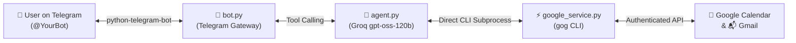

# 🤖 Executive Assistant Bot (Gmail & Google Calendar via Telegram)

A lightweight, high-performance personal AI executive assistant that manages your **Google Calendar** and **Gmail** directly from your **Telegram** account.

Built with Python, `python-telegram-bot`, `gog-cli`, and powered by high-throughput function calling on **Groq** (`openai/gpt-oss-120b`).

---

## ✨ Features

- **⚡ Blazing Fast:** ~1.5 to 2.5 second turnaround time per request using Groq's low-latency LLM inference.
- **🪶 Ultra Lightweight:** Consumes only ~35–50 MB of RAM (designed to run silently as a background service).
- **🔒 Whitelist Security:** Strict user ID authentication ensures only authorized Telegram accounts can trigger bot actions.
- **📅 Autonomous Calendar Management:**
  - View schedule for today or upcoming days (*"What's on my schedule today?"*).
  - Create events with natural language time parsing (*"Schedule team sync tomorrow from 2pm to 3pm"*).
  - Delete events (*"Cancel my gym session today"*).
  - Strictly lists verified events—never fabricates placeholder or filler blocks.
- **📬 Smart Gmail Management:**
  - Search and filter unread emails (*"Show emails from LinkedIn"*).
  - Summarize email threads with clean mobile formatting.
  - Senders hyperlinked directly to compose in Gmail (`[Sender](https://mail.google.com/mail/?view=cm&fs=1&to=...)`).
  - **💼 Job Alert Aggregation:** Automatically groups high-volume job alert emails by platform (LinkedIn, Indeed, etc.) so your priority emails stay uncluttered.
  - **🛡️ Safe Interactive Composing:** Preparing replies and sending new emails generates an interactive Telegram inline confirmation button (`[✅ Send Email]` / `[❌ Cancel]`) to prevent accidental dispatches.
- **🌅 Executive Morning Briefing:**
  - Automatically pushed every morning at **08:00 AM** (configurable to your timezone).
  - Available on-demand anytime via `/briefing`.
- **🔄 Fault-Tolerant & Boot Ready:**
  - Single-instance locking to prevent duplicate process conflicts.
  - Built-in 429 rate-limit backoff retry.
  - Windows silent startup script (`start_silent.vbs`) for auto-boot.

---

## 🏗️ Architecture



---

## 📁 Repository Structure

```
.
├── .env.example          # Sample environment variables template
├── .gitignore            # Git exclusion rules (protects credentials & logs)
├── README.md             # Project documentation
├── requirements.txt      # Python dependencies
├── config.py             # Configuration loader & validation
├── agent.py              # LLM agent, tool schemas & mobile prompt orchestration
├── bot.py                # Telegram bot handlers & daily briefing scheduler
├── google_service.py     # Clean wrapper for Google Calendar & Gmail operations
├── run.bat               # Interactive launcher with duplicate-instance check
├── status.bat            # One-click status checker
├── stop_bot.bat          # Graceful bot shutdown script
└── start_silent.vbs      # VBScript to run bot silently in background
```

---

## 🚀 Getting Started

### 1. Prerequisites
- Python 3.11 or 3.12 installed.
- [gog-cli](https://github.com/google/gogcli) installed and authenticated with your Google account:
  ```bash
  gog auth add your_email@gmail.com
  ```
- A Telegram Bot token from [@BotFather](https://t.me/BotFather).
- A free API key from [Groq Console](https://console.groq.com/).

### 2. Installation
1. Clone the repository:
   ```bash
   git clone <your-repo-url>
   cd <repo-folder>
   ```

2. Install dependencies:
   ```bash
   pip install -r requirements.txt
   ```

3. Configure environment variables:
   Copy `.env.example` to `.env`:
   ```bash
   copy .env.example .env
   ```
   Fill in your actual tokens and user ID in `.env`:
   ```ini
   TELEGRAM_BOT_TOKEN=your_bot_token_from_botfather
   TELEGRAM_ALLOWED_USER_ID=your_numeric_telegram_user_id
   GROQ_API_KEY=your_groq_api_key
   GROQ_MODEL=openai/gpt-oss-120b
   TIMEZONE=Asia/Dubai
   BRIEFING_TIME=08:00
   ```

### 3. Running the Bot

- **To run in terminal:**
  ```bash
  python bot.py
  ```
  *or double-click `run.bat`.*

- **To check status:**
  Double-click `status.bat`.

- **To run silently in the background:**
  Double-click `start_silent.vbs`.

- **To auto-start on Windows boot:**
  Copy `start_silent.vbs` (or a shortcut to it) into your Windows Startup folder:
  `Win + R` → `shell:startup` → paste shortcut.

---

## 💬 Usage Examples

| Intent | Example Prompt to Bot |
| :--- | :--- |
| **Morning Briefing** | `/briefing` |
| **Check Calendar** | *"What's on my schedule today?"* |
| **Create Event** | *"Book Doctor Appointment tomorrow from 3pm to 4pm"* |
| **Delete Event** | *"Cancel my haircut today"* |
| **Check Emails** | *"Show my unread emails"* |
| **Job Searches** | *"Check job alerts from LinkedIn"* |
| **Draft / Reply** | *"Reply to John saying I received the proposal"* *(Bot asks for confirmation first)* |

---

## 📄 License
MIT License
