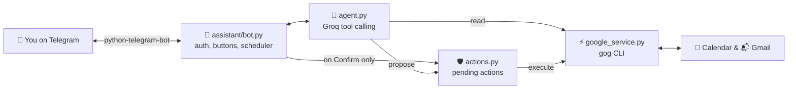

# 🤖 Executive Assistant Bot (Gmail & Google Calendar via Telegram)

A lightweight personal AI assistant that manages your **Google Calendar** and **Gmail** from **Telegram**.

Built with Python, `python-telegram-bot`, [`gog`](https://github.com/steipete/gogcli) and tool calling on **Groq** (`openai/gpt-oss-120b`).

---

## ✨ Features

- **📅 Calendar:** view today or upcoming days, search events, create and delete events in natural language.
- **📬 Gmail:** search and summarise email, draft new emails and replies.
- **💼 Job-alert aggregation:** LinkedIn/Indeed-style alerts are grouped by platform so priority mail stands out.
- **🌅 Morning briefing:** pushed daily at a configurable time, or on demand with `/briefing`.
- **🪟 Windows friendly:** run in a console, silently in the background, or at login.

## 🛡️ Safety guardrails

| Guardrail | How it works |
| :--- | :--- |
| **Single authorised user** | `TELEGRAM_ALLOWED_USER_ID` is required. The bot refuses to start without it and only answers that user, in a private chat. |
| **Confirm before any change** | Sending, replying, creating and deleting are only *proposed* by the AI. You get a preview built from the exact stored details (recipient, subject, body, event time) with Confirm/Cancel buttons. Proposals expire after 15 minutes and can be confirmed only once. |
| **Prompt-injection defence** | Email and calendar text is marked as untrusted third-party content (gog `--wrap-untrusted`). The AI is told never to follow instructions inside it, and even if it did, nothing happens without your confirmation. The briefing has no tools at all. |
| **Least-privilege CLI calls** | Each `gog` call is limited to the one command it needs (`--enable-commands`), reads run with `--readonly`, values are passed after `--` with no shell, and every call has a timeout. |
| **Input validation** | Recipient addresses, IDs, subjects, bodies and event times are validated; result counts and date ranges are capped. |
| **Secret hygiene** | Secrets live only in `.env` (git-ignored). Logs (`runtime/bot.log`) redact tokens and API keys, and rotate at 1 MB. |
| **Single instance** | An OS file lock prevents two copies from running; `runtime/bot.pid` lets the scripts find the process. |

### Privacy note

To answer you, the bot sends the content of the emails and events it reads (subjects, senders, previews) and your messages to **Groq's API**. Don't use it with mail you aren't comfortable sharing with that provider. Conversation history is kept in memory only (last 8 exchanges, cleared on restart or with `/reset`).

---

## 🏗️ Architecture



## 📁 Repository structure

```
.
├── assistant/               # the bot (Python package, run with `python -m assistant`)
│   ├── __main__.py          # entry point
│   ├── bot.py               # Telegram handlers, authorisation, confirmations, daily briefing
│   ├── agent.py             # LLM tool schemas, tool loop, system prompt, briefing
│   ├── actions.py           # confirmation gate: validated pending actions + execution
│   ├── google_service.py    # gog CLI wrapper (validation, timeouts, least privilege)
│   ├── config.py            # loads and validates .env (fails closed)
│   ├── logging_setup.py     # rotating log with secret redaction
│   ├── instance_lock.py     # single-instance lock + PID file
│   └── paths.py             # file locations
├── scripts/windows/         # run.bat, start_silent.vbs, status.bat, stop_bot.bat
├── tests/                   # pytest suite for the safety behaviour
├── runtime/                 # created at run time: bot.log, bot.pid, bot.lock (git-ignored)
├── .env.example
├── pyproject.toml / requirements.txt / requirements-dev.txt
└── README.md / LICENSE
```

---

## 🚀 Getting started

### 1. Prerequisites
- Python 3.11+.
- [`gog`](https://github.com/steipete/gogcli) v0.48 or later, signed in to your Google account (`gog auth add you@gmail.com`).
- A Telegram bot token from [@BotFather](https://t.me/BotFather) and your numeric user ID (e.g. from @userinfobot).
- A Groq API key from the [Groq Console](https://console.groq.com/).

### 2. Install
```bash
git clone https://github.com/AbdulRahmaan03/gmail-calendar-assistant-bot.git
cd gmail-calendar-assistant-bot
pip install -r requirements.txt
copy .env.example .env
```
Then fill in `.env` (token, your user ID, Groq key, timezone, briefing time).

### 3. Run
- **Console:** `python -m assistant` from the project folder, or double-click `scripts\windows\run.bat`.
- **Background:** double-click `scripts\windows\start_silent.vbs`.
- **At login:** `Win + R` → `shell:startup` → put a shortcut to `scripts\windows\start_silent.vbs` there.
- **Status / stop:** `scripts\windows\status.bat` / `scripts\windows\stop_bot.bat`.

Logs are written to `runtime/bot.log`.

### 4. Develop
```bash
pip install -r requirements-dev.txt
ruff check .
pytest
```

---

## 💬 Usage examples

| Intent | Example |
| :--- | :--- |
| Morning briefing | `/briefing` |
| Check calendar | "What's on my schedule today?" |
| Create event | "Book a doctor appointment tomorrow from 3pm to 4pm" → tap **Create event** |
| Delete event | "Cancel my haircut today" → tap **Delete event** |
| Check email | "Show my unread emails" |
| Reply | "Reply to John saying I received the proposal" → review → tap **Send reply** |
| Forget context | `/reset` |

## 📄 License
[MIT](LICENSE)
